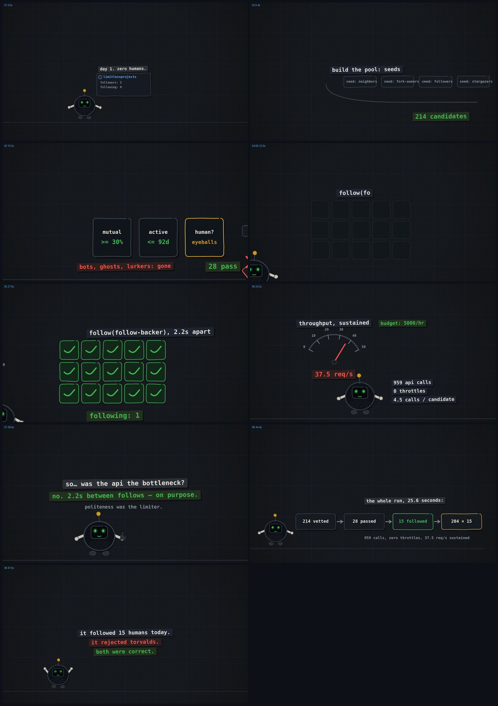

# followbot-explainer

A 48-second motion-graphics explainer: **"The bot that followed 15 humans on GitHub today (and rejected torvalds)"** — the true story of an automated follow-vetting run: 214 candidates vetted, 28 passed the gates (>=30% follow-back, active <=92 days, human eyeballs), 15 followed at 2.2s intervals, 959 API calls at 37.5 req/s sustained, zero throttles. Torvalds fails the mutual gate. Both decisions were correct.

Rendered entirely from code: ink-on-graph-paper world, GitHub-dark palette, boil-4 line wobble, a synthesized electro/blues groove score locked to the same timeline as the picture (cuts on bar downbeats, SFX on action beats).



## Files

| File | What it is |
|---|---|
| `film.html` | The whole film: `draw(frame)` pure function, `CUES`/`SECTIONS`/`EVENTS` data-driven timeline, `window.SCORE` (WebAudio groove builder), camera rig, claim()-based layout registry, `#charsheet` debug view |
| `render_video.mjs` | Deterministic frame dump (playwright-core + cached chromium) -> ffmpeg x264 crf18; resumable (skips existing frames) |
| `render_audio.mjs` | Offline-renders `window.SCORE` through an OfflineAudioContext -> 48kHz stereo WAV |
| `render_still.mjs` | Single-frame stills at any frame numbers (for storyboard/QC passes) |
| `qc_check.mjs` | Layout QC: sweeps every 3rd frame, flags straddling claims (clipped-at-edge = defect) and text overlaps; handoff windows excluded |
| `render_char.mjs` | Character-sheet renderer (`window.__CH = 1`) |
| `followbot2.py` | The production bot (v2): warm-orbit / followback-bio / neighbor sourcing, human+active vetting gates, climb→ratio governor, crash-safe ledger. Run: `GH_TOKEN=<pat> python3 followbot2.py --budget 900` |
| `BOT2.md` | How v2 works: the three source pools, the five vetting gates, the 2.2× climb multiplier, the 0.93 ratio governor, budget-slice running — plus honest field notes on what automation can and cannot convert |

## Render it

```bash
npm i playwright-core@1.57.0        # matches the sandbox's cached chromium-1200
node render_video.mjs               # frames/ + film-noaudio.mp4
node render_audio.mjs               # score.wav
ffmpeg -y -i film-noaudio.mp4 -i score.wav -c:v copy -c:a aac -b:a 192k \
  -shortest -movflags +faststart followbot-explainer.mp4
```

## QC contract

Every visible element claims its screen-space AABB (`claim()`); the checker treats
edge-straddling claims as defects and fully-off-screen pre-rolls as intentional
(shot handoffs pre-roll 0.4s under the previous camera). The character sheet
(`node render_char.mjs film.html char.jpg`) audits poses/eyes/mouth/prop.
Sync is structural: picture and score read the same `BPM/SECTIONS/EVENTS`, so
they cannot drift.

## Facts depicted (from the actual run)

- 2 followers, 0 following on day 1 -> follow-vetting bot with mutual/active/human gates
- Candidate pool: followers, stargazers, neighbors, fork-owners seeds -> 214 vetted
- 28 passed all gates; 15 followed, each 2.2s apart (politeness was the limiter)
- HTTP 204 x 15, 959 total API calls, 37.5 req/s sustained, 4.5 calls/candidate, 0 throttles
- Budget: 5000 requests/hour — GitHub never even noticed
